# Landing page review — Sunny Owl step 2

Base: main `96531488` (merged foundations). Branch: `redesign/2-landing`.
Reviewed 28 October 2026. No merge or manual deployment.

## Scope and behaviour

Signed-out `/` renders `LandingPage` within `PublicLayout`. The new public header
and footer apply only there. `/login`, `/?verified=true`, policy and help pages
retain the calmer public layout. No auth, registration, Turnstile, data, route,
server or settings implementation changes.

All signup actions still navigate to `/login?mode=register`; sign-in still uses
`/login`. Existing footer destinations, feedback, Voice & display settings and
storage-notice behaviour remain. The original heading IDs and skip-link target
`#main-content` remain. The focused skip link now stays visibly above the header.

The sample question is a labelled, non-interactive illustration. Its Listen badge
and shaped answers do not introduce speech or quiz behaviour. MiRa explains the
answer; Wura is decorative. All art uses the supplied foundations or board SVG.

## Copy and reference differences

- Adopted the design headline, Start learning / Create a family account labels,
  the four learning-card titles, Every Key Stage 2 subject, How a session works,
  and For parents and carers / For teachers.
- Kept the app's curriculum, free account, child-profile/PIN/parent-code,
  progress, Spelling Bee, rewards, mini-games and SATs information, reorganised
  into the new sections. Added Languages as the ninth illustrated subject;
  retained the existing Art & Design name.
- Used the app's factual read-aloud/visual-settings wording rather than promising
  that everything can be spoken. The copy does not promise full screen-reader
  support, one idea per screen, user-controlled timers, dark mode or a selectable
  calm tint that were not established by this implementation.
- Grown-up cards open the existing `/parent-guide` and `/teacher-guide` routes
  rather than the design tool's dashboard filenames. Registration and role
  permissions remain unchanged.
- Correct answer uses ink text and outline, a tick, the word Correct, and a leaf
  tint, following the brief instead of the prototype's teal text/outline.
- Kept copyright, Feedback, Voice & display settings and the existing final free
  account CTA/information; the footer/page are consequently taller than the
  mock-up. Phone navigation wraps into visible rows; no new menu behaviour.

## Checks

Using Node 20 (the project's CI version):

| Check | Result |
| --- | --- |
| `npm run lint` | Pass, no errors or warnings |
| `npm test -- --run` | Pass, 226 tests across 46 files |
| `npm run build` | Pass; `precache 126 entries (3874.38 KiB)` |
| `git diff --check` | Pass |
| Local browser | Safari Private Browsing, Responsive Design Mode, 1280×900 and 390×900 |
| Keyboard | Desktop reverse-tab reaches visible skip link; Return targets main. Phone Option-Tab reaches Start learning; Return opens `/login?mode=register` |
| Display settings | Existing High Contrast Mode and Large Text switches checked separately at both widths |
| Motion | Existing Reduced Motion switch sets root gate; computed cloud animation is `none` at both widths |
| Fonts | Fredoka heading and Atkinson Hyperlegible body confirmed by computed styles; both `document.fonts.check` calls return true |

Read-only browser measurements after the final styling:

| Viewport | Document scroll width | Smallest target height | Smallest target width | Reduced motion cloud animation |
| --- | --- | --- | --- | --- |
| 1280px | 1280px | 48px | 48px | `none` |
| 390px | 390px | 48px | 48px | `none` |

The target measurement includes header links/buttons, landing CTAs and footer
buttons. High contrast removes tints, pattern and scenery, retaining the app's
white-on-black colours. Larger text reflows the hero and grids. Existing Sunny
Owl CSS also gates motion through `prefers-reduced-motion`; the OS preference
itself was not changed during this review.

Browser observations: no new rendering exception or CSP violation observed. The
local development console reports `Sentry DSN not configured - error tracking
disabled`, `[Version] Check failed (expected on first deploy):` with `SyntaxError:
The string did not match the expected pattern.`, and Firebase's warning that
127.0.0.1 is not an authorised OAuth domain. No settings or secrets were changed.
One repeated reload on port 3010 remained at the existing “Brewing up some
knowledge...” auth loading screen; the cause was not established. Final captures
and checks were repeated successfully on fresh local dev origin 3011, with the
real public route and without an auth bypass or fixture. Google sign-in/account
creation was not attempted.

Screenshots are unedited native Safari captures. The responsive viewport is
scaled to fit the window; they are viewport captures, with extra scrolled views
below rather than a stitched full-page image. Before images were captured from
the foundation main before any landing edits. Essential-storage notice was
dismissed locally for the captures.

## Before and after

| Width | Before | After |
| --- | --- | --- |
| 1280 | 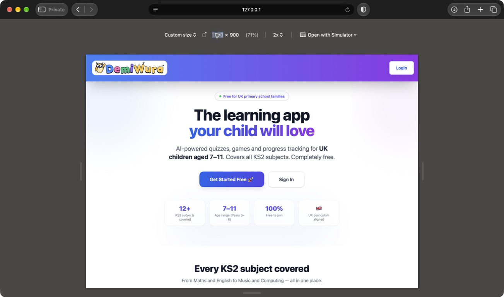 | 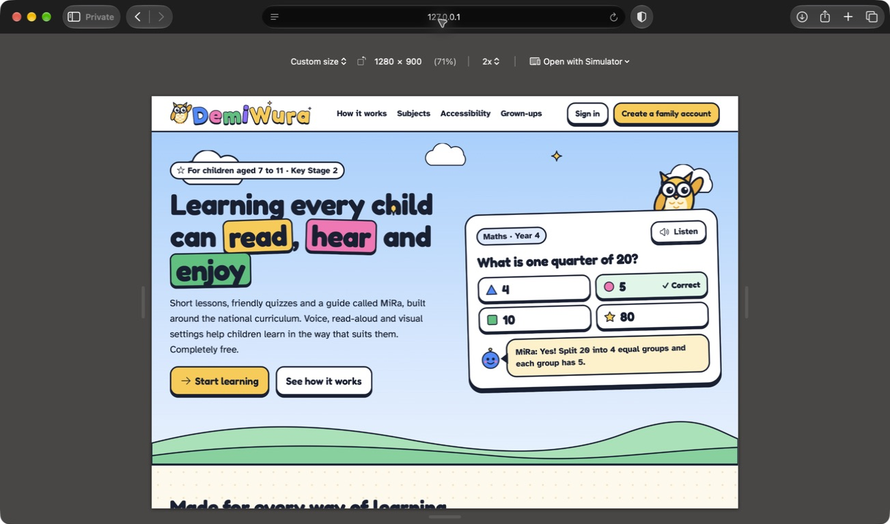 |
| 390 | 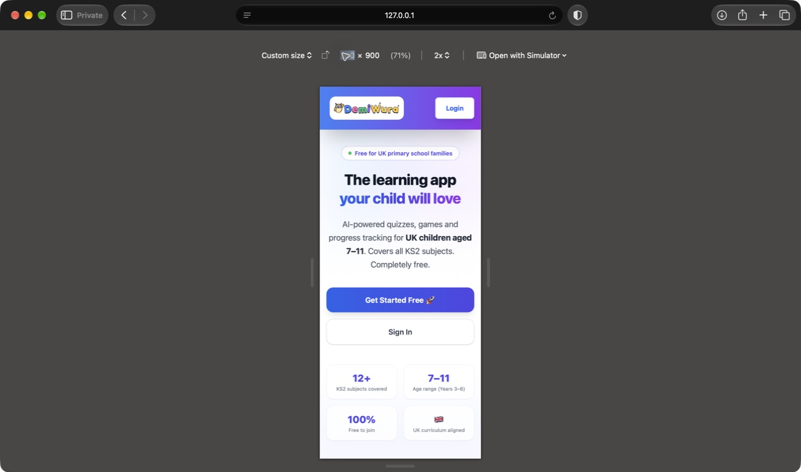 | 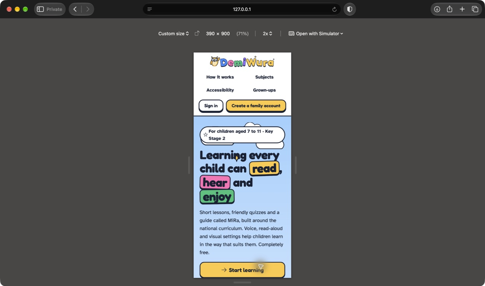 |

## Additional views

| Area | Desktop | Phone |
| --- | --- | --- |
| Learning cards | 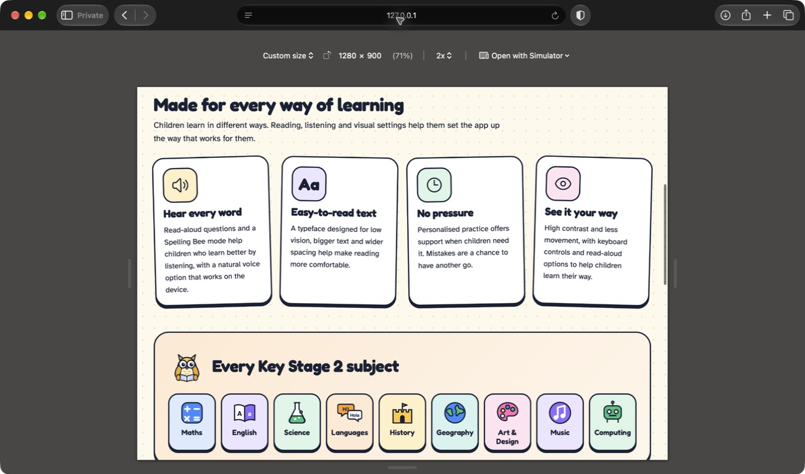 | 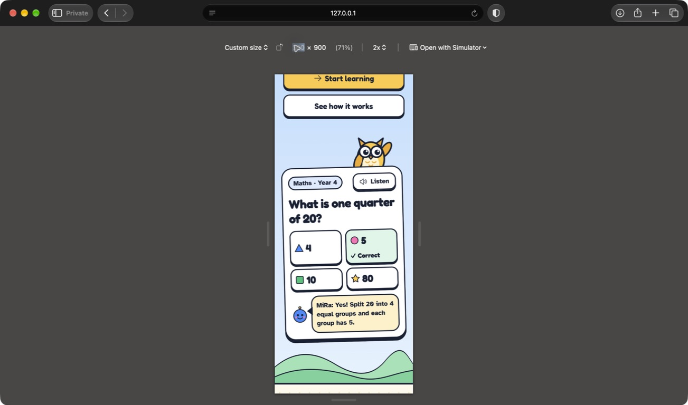 |
| Session / maths | 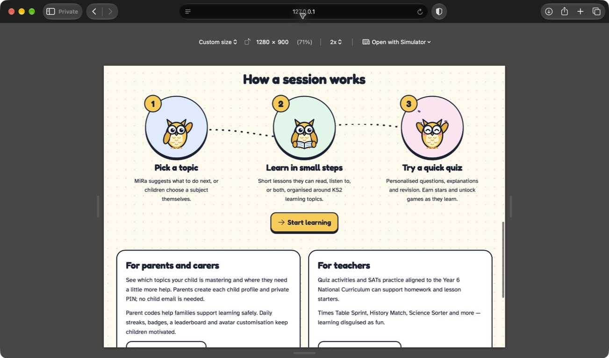 | 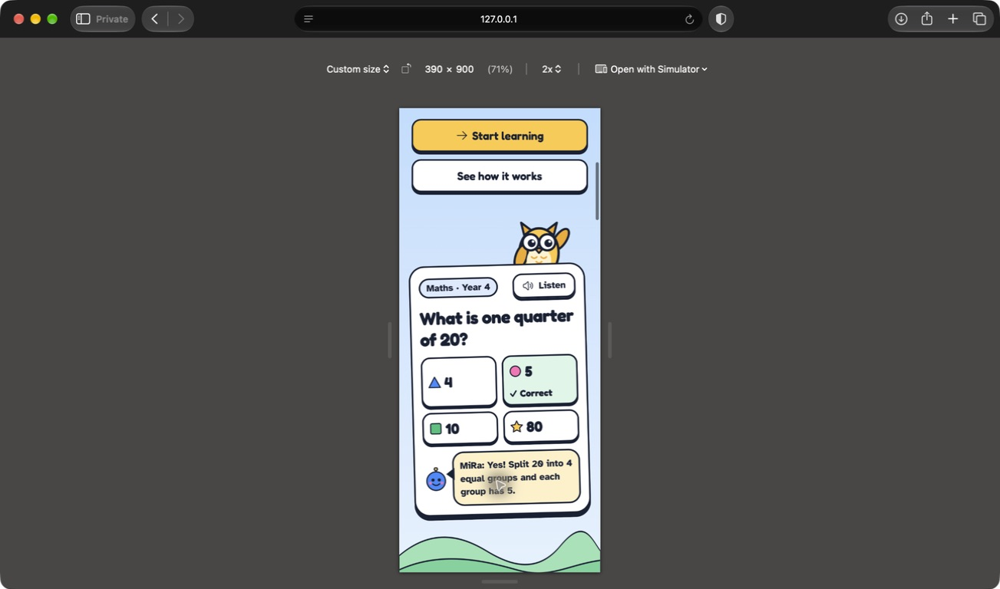 |
| Footer | 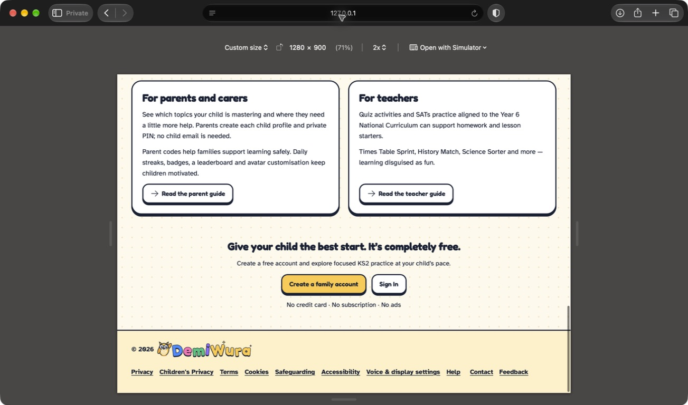 | 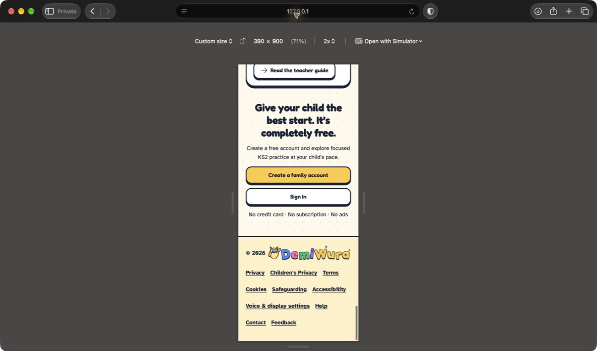 |
| High contrast | 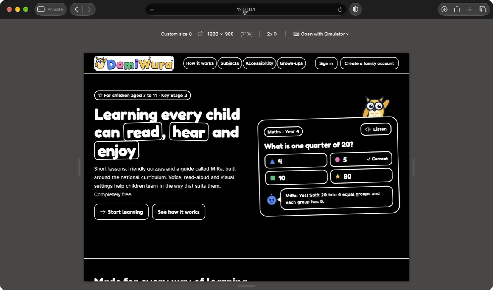 | 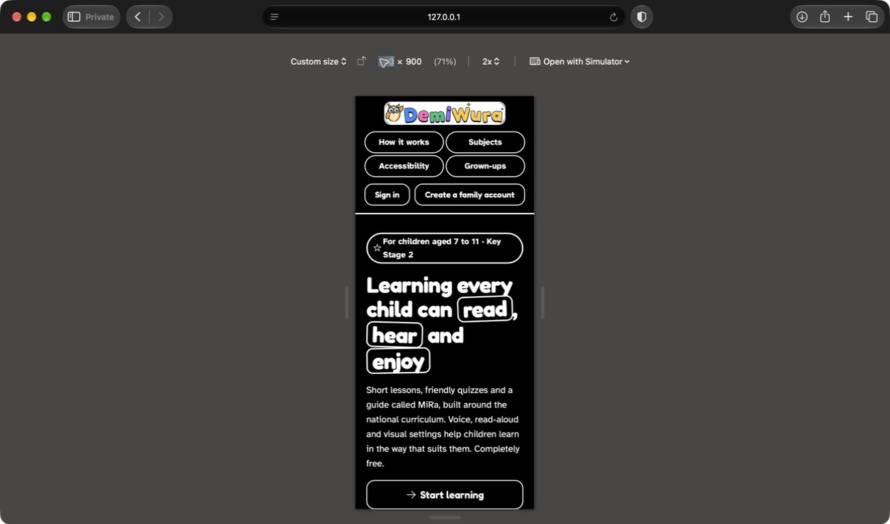 |
| Large text | 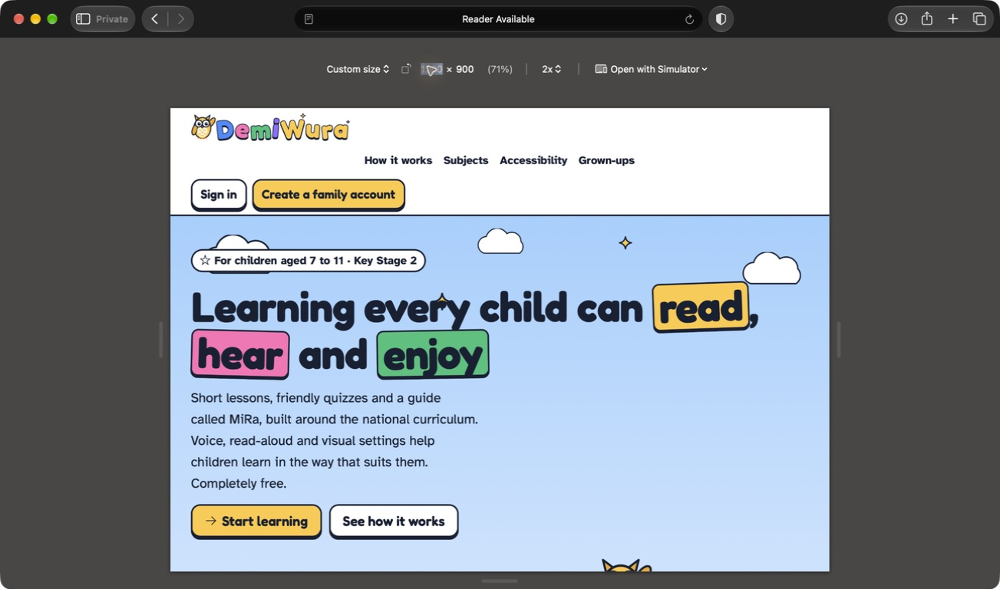 | 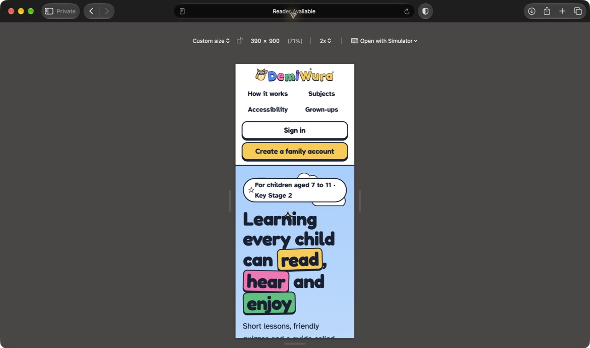 |
| Keyboard focus | 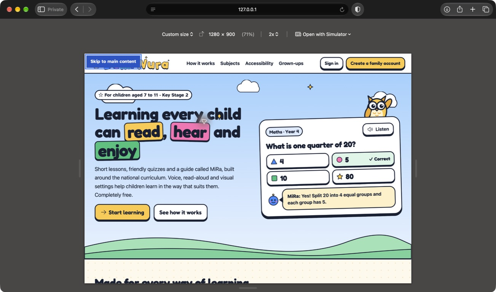 | 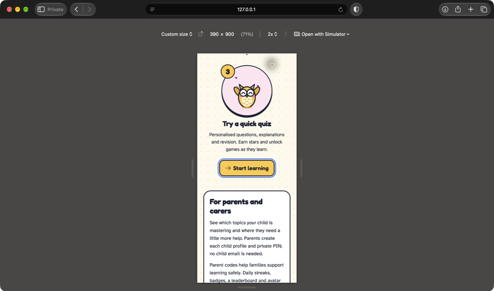 |

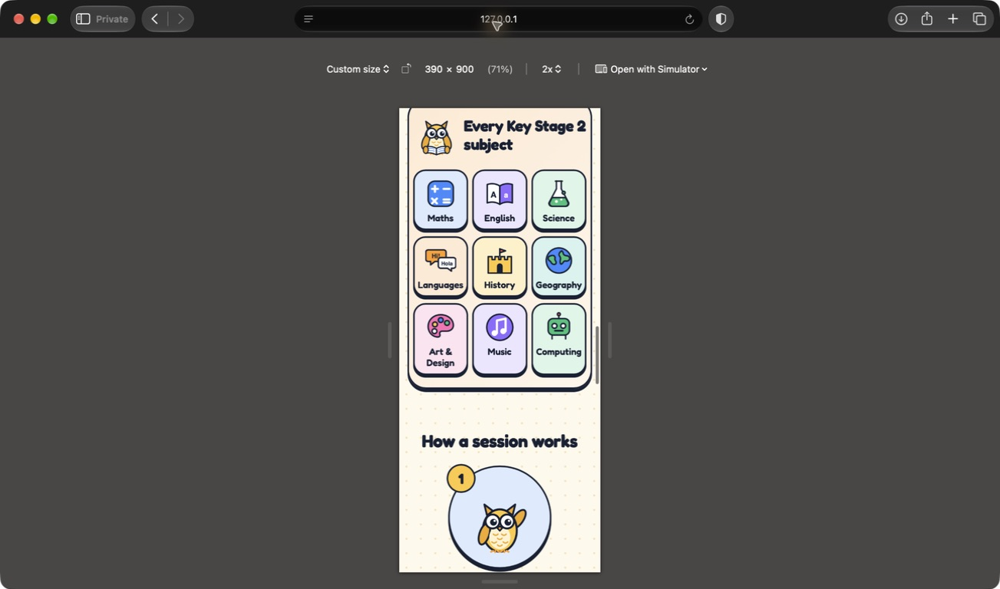
