# Sunny Owl sign-in review

Branch: `redesign/3-sign-in`, based on main `96531488` (foundations PR #6).
The landing PR is independent of this change. No merge or deployment.

## Actual flow and design adaptations

`App.tsx` renders `LoginView` inside `PublicLayout` for signed-out sign-in.
`ChildSelector` is rendered by `ParentMonitoringDashboard`, after parent sign-in.
The current app does not have a signed-out child-picture picker or picture-code
login. It asks for name, age, a six-character parent code and a private numeric
PIN of four to six digits. Those fields and the existing Parent / Teacher / Child
and Sign In / Create Account switches remain in the same flow.

- The waving owl's bubble says “Enter your details, then your secret PIN!” so it
  matches the actual numeric flow. Four decorative, non-interactive guide cards
  represent the existing fields; they are hidden from assistive technology.
- There are no three-picture slots, six picture-code buttons or Start again
  action: adding them would change authentication/input/reset behaviour.
- The actual parent-portal child buttons get large round versions of their
  existing emoji, existing name/age labels and monitoring marker. No new avatar
  data, stored images or child enumeration is introduced on the public page.
- The existing permission-gated “+ Add child and PIN” button becomes a dashed
  card and opens the same creation form. All management callbacks remain.
- The grown-up form stays white with outlined fields and buttons. Only the
  selected form is rendered, as before, rather than two simultaneous auth forms.
- `LoginView` does not expose a Google sign-in button. None was added or removed.
  The shared public header/footer and their routes are unchanged in this step;
  the mock-up's extra page-read-aloud control was not added.
- Existing heading text, helper text, errors and status messages are retained.
  New copy is limited to the owl introduction and decorative field guide.

## Behaviour checks

The state, effects and handlers above each component's render match main exactly.
An AST comparison also confirmed all 81 existing LoginView event/input/test-ID/
accessibility attributes and all 50 ChildSelector attributes were retained.
The added data attributes are styling hooks; the added aria-hidden guide is
ordinary decoration, not an announcement.

New regression tests use nonexistent synthetic fixtures and mocked services.
They cover numeric PIN sanitisation and payloads, validation/server errors,
Turnstile gating and token forwarding, parent sign-in and password visibility
labels, registration/email verification, verification-return/reset messages,
child selection and permission-gated creation, and the existing alert/status
announcements. They do not stand in for a real account sign-in test.

## Automated checks

Node 20, matching project CI:

- `npm run lint`: passed, zero errors/warnings.
- `npm test -- --run`: passed, 225 tests in 47 files.
- `npm run build`: passed, `precache 125 entries (3865.02 KiB)`.
- `git diff --check`: passed.

Local dependencies were restored with `npm ci` from the unchanged lockfile after
missing local tool binaries prevented one rerun. The commands above then passed
on the final source, with all temporary visual fixtures removed.

Files changed: `components/LoginView.tsx`, `components/ChildSelector.tsx`, new
`components/SignIn.css`, `components/LoginView.test.tsx`,
`components/ChildSelector.test.tsx`, and these review notes/screenshots.

## Visual review

Chrome for Testing 145, responsive CSS viewports 1280×900 and 390×900, DPR 2.
Screenshots are Chrome's unedited full-size captures, saved through DevTools.
Image widths are 2560px and 780px respectively. The page is scrolled to the top
before capture to avoid sticky-header offsets.

Login screenshots use the real public route. Before images use a preserved build
of main; after images use `npm run dev`. ChildSelector screenshots use a temporary
isolated component fixture, clearly labelled as synthetic profiles with no account
data or network writes. The same fixture rendered the original and new component.
All fixture source files were removed before final checks and commit.

| Measured component | Viewport | Document width | Minimum control height |
| --- | --- | --- | --- |
| Sign-in | 1280px | 1280px | 50px |
| Sign-in | 390px | 390px | 50px |
| Child picker | 1280px | 1280px | 51.2px |
| Child picker | 390px | 390px | 51.2px |

Both components use self-hosted Atkinson Hyperlegible with Fredoka headings.
Targets have CSS minimum dimensions 48×48px; fields have minimum height 56px.
Focus is 4px action-blue. The real Reduced Motion switch was enabled through the
existing settings dialog; the root gate became true and computed sparkle animation
was `none` at both widths. New transitions also require OS no-preference and are
disabled by either reduced-motion switch. The OS preference itself was not changed.

The initial Safari/Chrome connections returned `cgWindowNotFound`; the fresh
Chrome for Testing window provided the successful captures. Its local console
shows Firebase's existing “The current domain is not authorized for OAuth
operations” warning for 127.0.0.1. No OAuth/Firebase or Cloudflare settings changed.

## Real sign-in limitation

The plain Vite dev server does not run Pages Functions. Production's child-session
preflight rejects Origin `http://127.0.0.1:3013` with HTTP 403. No origin headers,
Turnstile requirements, authentication handlers, secrets or server safeguards
were changed to work around that restriction.

At the user's request, production child sign-in was opened separately in Chrome
for Testing for the user to enter a test account directly. No account details or
credentials have been recorded in these notes or screenshots. A successful real
account sign-in has not yet been observed; this check remains pending. An online
check would exercise production's existing UI/backend, not this undeployed branch.

## Before and after

| View | Before | After |
| --- | --- | --- |
| Grown-up 1280 | 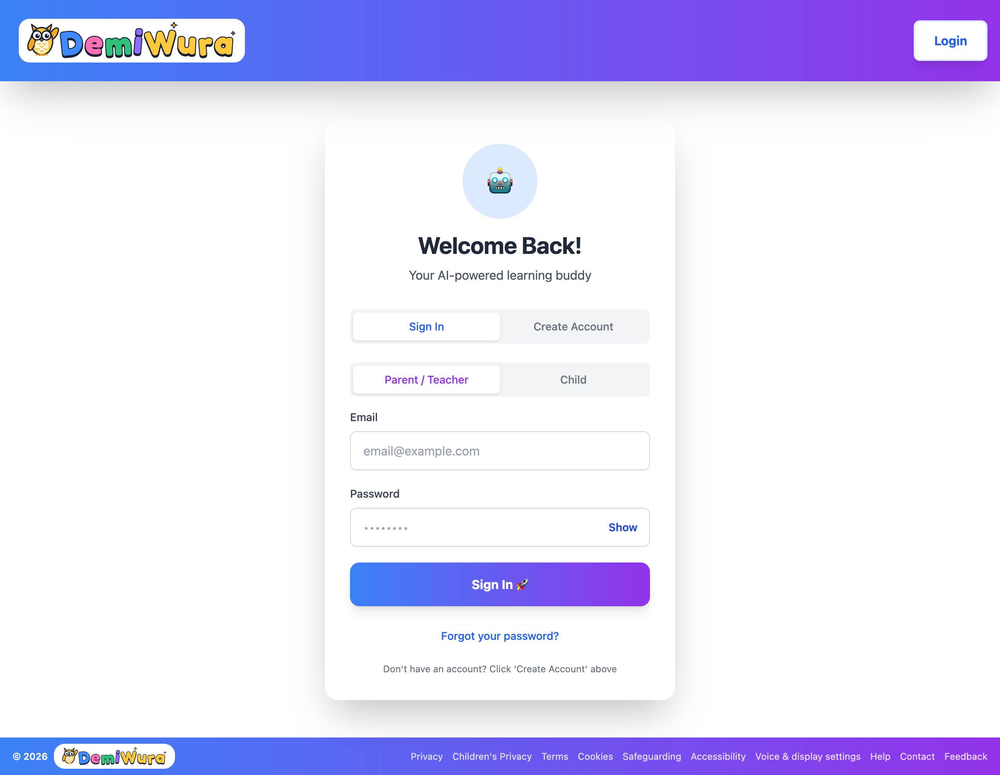 | 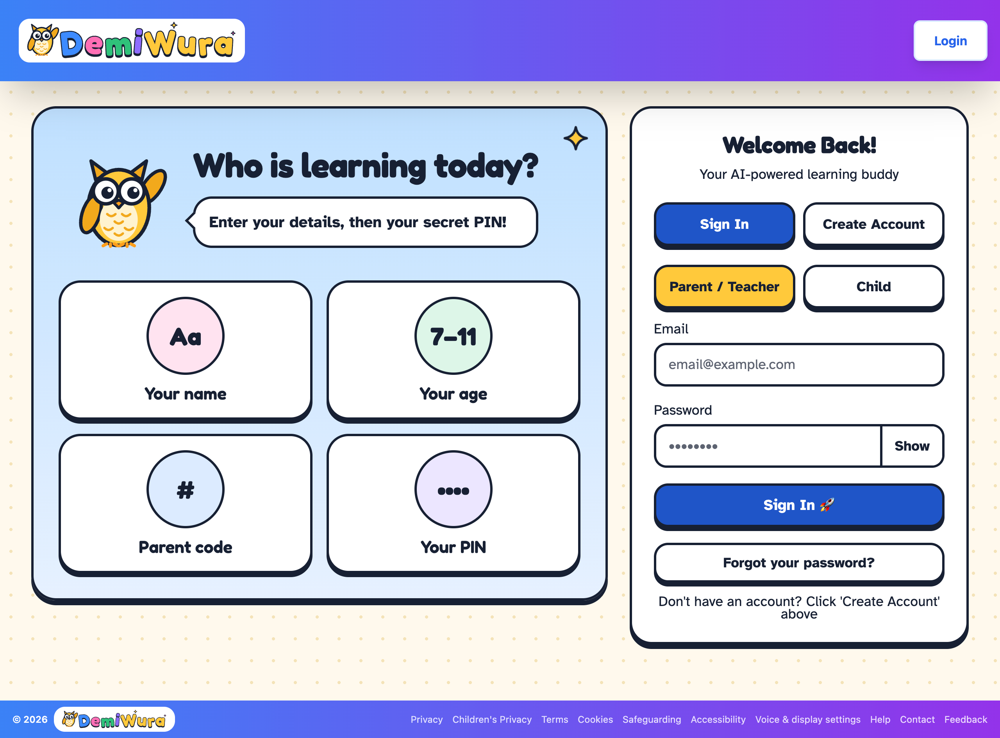 |
| Grown-up 390 | 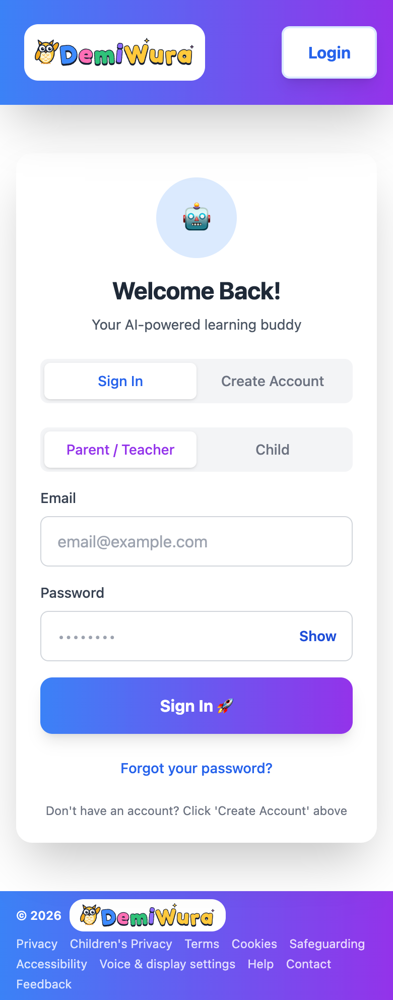 | 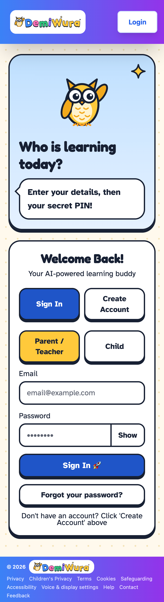 |
| Child 1280 | 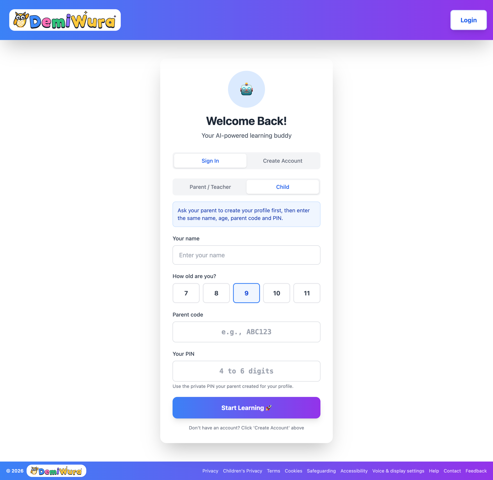 | 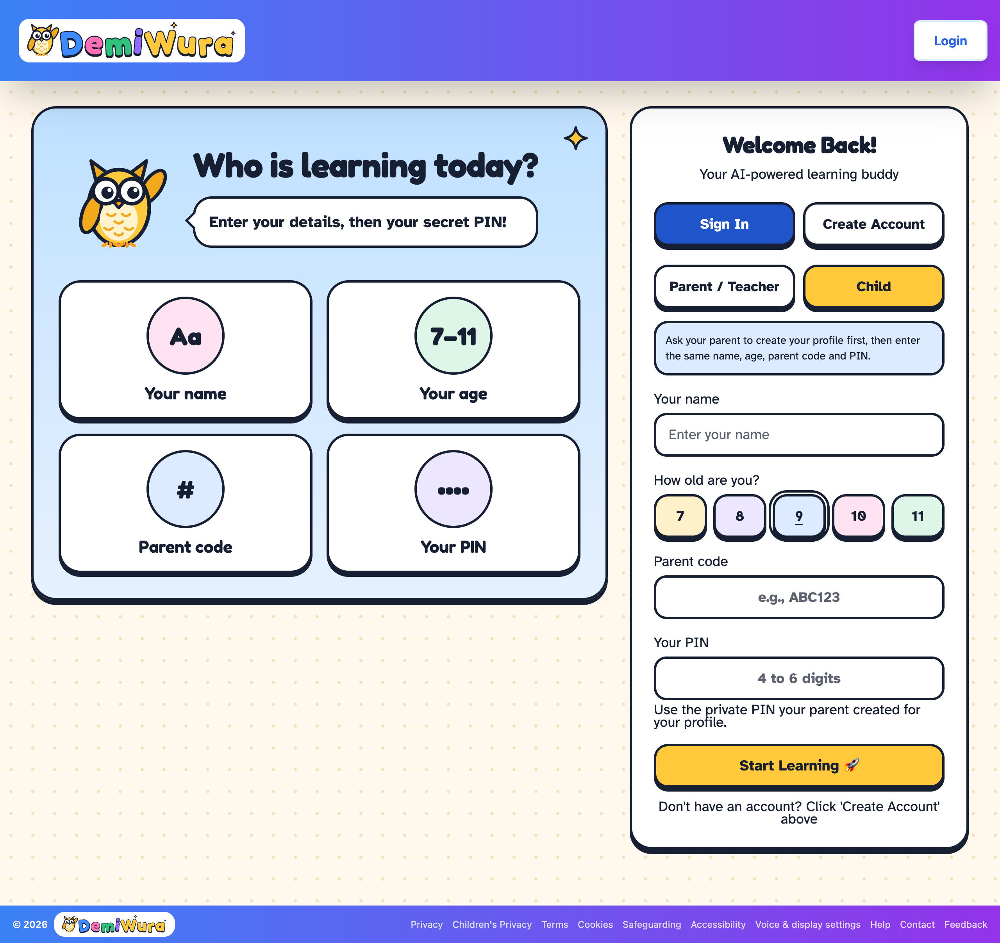 |
| Child 390 | 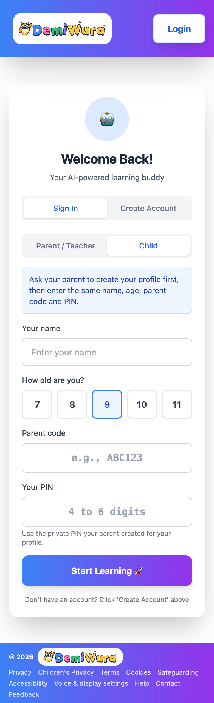 |  |
| Picker 1280 | 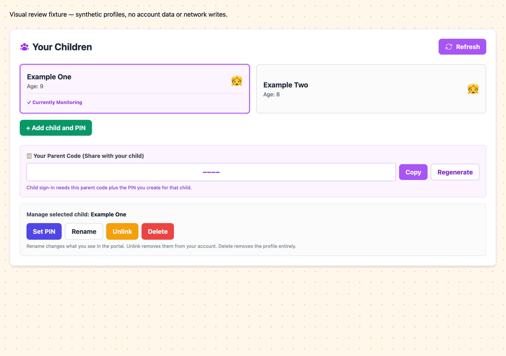 | 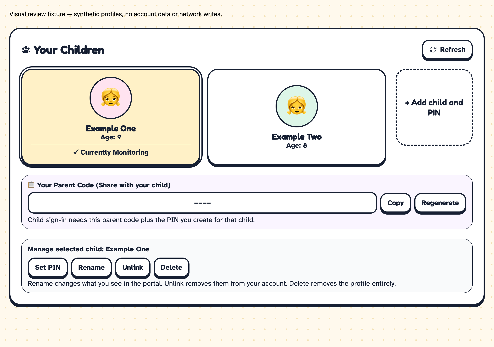 |
| Picker 390 | 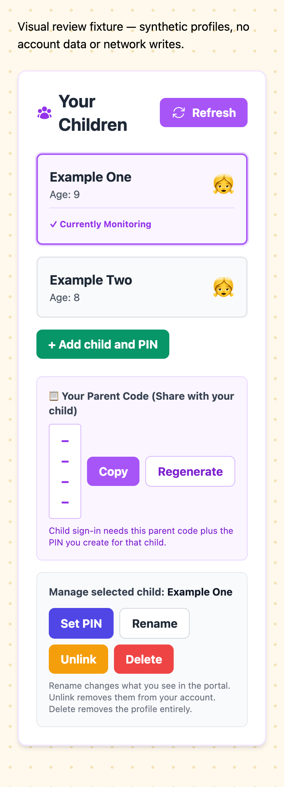 | 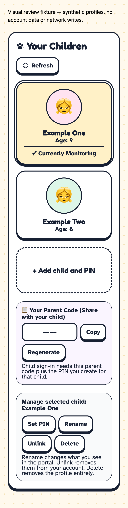 |
